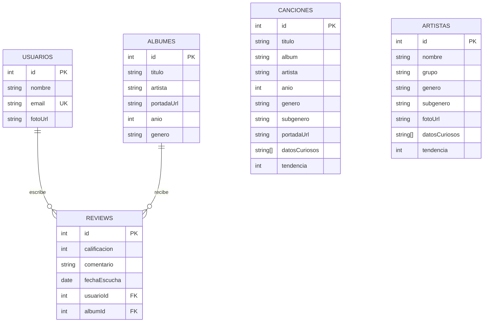
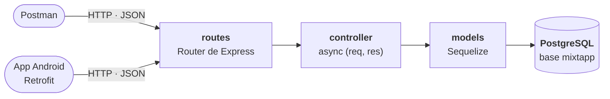

# Mixtapp Backend

**La API REST de Mixtapp: usuarios, álbumes, canciones, artistas y las reseñas de los álbumes.**

Mixtapp Backend es la API de [Mixtapp](https://github.com/AndresContreras1/Mixtapp), la app Android donde
abres un álbum, le pones una calificación y escribes tu reseña. Expone los usuarios y los álbumes en modo
lectura y un CRUD completo de reseñas, cada una ligada a un usuario y a un álbum. También tiene las canciones y
los artistas del catálogo de la app, en modo lectura. Está hecha con Node.js, Express y Sequelize sobre
PostgreSQL. Es la entrega del sprint 8 de Computación Móvil, ajustada en el sprint 9 para que la app la consuma
con Retrofit.


> [!NOTE]
> No hay autenticación: el enunciado del sprint la deja por fuera. Las tablas se crean con `sync()` sin
> `force: true`, así que lo que se crea desde la app o desde Postman se conserva al reiniciar el servidor. Los
> datos iniciales solo se cargan cuando la tabla está vacía. Para volver a ellos, borra las tablas en DBeaver
> y arranca otra vez.

## Contenido

[Qué hace](#qué-hace) · [Funcionalidades](#funcionalidades) · [Arquitectura](#arquitectura) ·
[Cómo ejecutarlo](#cómo-ejecutarlo) · [Endpoints](#endpoints) · [Pruebas con Postman](#pruebas-con-postman) ·
[Consumo desde la app](#consumo-desde-la-app) · [Estructura](#estructura)

## Qué hace



Un usuario escribe muchas reseñas y un álbum recibe muchas; cada reseña pertenece a un solo usuario y a un
solo álbum. Antes de guardar una reseña, la API comprueba que el usuario y el álbum existan, y las dos llaves
foráneas quedan también en PostgreSQL, así que no puede quedar una reseña apuntando a algo que no existe. La
calificación va de 0 a 5 y el comentario tiene hasta 500 caracteres, igual que en la app.

Las canciones y los artistas no tienen relaciones: son el catálogo que la app muestra, de cinco géneros (metal,
nu metal, rock, reggaetón y música popular). `datosCuriosos` es un arreglo de textos de PostgreSQL con las
secciones de los datos curiosos que la app guarda en Firestore, y `tendencia` es la posición en la lista de
Deezer de su género del 1 de noviembre de 2026, o `null` si no está en la lista. La canción guarda el nombre de
su álbum como texto, porque no todos sus álbumes están en la tabla `albumes`.

Los datos iniciales solo se cargan si la tabla está vacía: para pasar al catálogo nuevo hay que vaciar las
tablas `canciones` y `artistas` (`TRUNCATE canciones, artistas RESTART IDENTITY;` en psql) y volver a
arrancar el servidor.

## Funcionalidades

| Área | Qué tiene |
|---|---|
| **Usuarios** | Todos los usuarios, uno por id y sus reseñas con el álbum de cada una. |
| **Álbumes** | Todos los álbumes, el detalle de uno por id, y sus reseñas con el usuario que escribió cada una. |
| **Reseñas** | Todas las reseñas con el usuario que escribió cada una, de la más nueva a la más vieja (con el id como segundo criterio, para que el orden no cambie). Crear con id de usuario, id de álbum, calificación de 0 a 5, comentario y fecha de escucha; modificar y eliminar por id. |
| **Canciones y artistas** | Todas las canciones y todos los artistas del catálogo de la app, y uno por id. |
| **Datos iniciales** | 5 usuarios, 8 álbumes con sus portadas, 12 reseñas, 126 canciones y 56 artistas, cargados con `count()` y `bulkCreate` solo si la tabla está vacía. Las canciones y los artistas son el mismo catálogo real de Firestore, con portadas de 1000 px y datos curiosos. Los 5 usuarios escribieron alguna y todos los álbumes, salvo *Random Access Memories*, tienen al menos una. El usuario 1 es el de la app, con las 4 reseñas de su perfil, y los ids de los álbumes coinciden con los de la app. |
| **Errores** | `400` en JSON cuando la calificación no va de 0 a 5, `404` cuando el usuario, el álbum, la reseña, la canción o el artista no existen, y `500` cuando una consulta falla. |

## Arquitectura



Cada petición entra por un router, que la pasa a una función del controlador; el controlador consulta con los
modelos de Sequelize y responde JSON. Las relaciones se declaran en `models/relations.js`, y el arranque sigue
siempre el mismo orden: conectar, crear las tablas que no existan, crear las relaciones y cargar los datos.

| Capa | Tecnología |
|---|---|
| Servidor | Node.js · Express 5 |
| Datos | PostgreSQL 17 · Sequelize 6 con `pg` y `pg-hstore` |
| Desarrollo | nodemon |
| Herramientas | DBeaver para ver la base · Postman para las peticiones |

## Cómo ejecutarlo

Necesitas Node.js y PostgreSQL escuchando en el puerto 5432.

1. Crea la base `mixtapp`. En DBeaver: conexión a PostgreSQL, *Databases → Crear nueva base de datos*.
2. Clona el repositorio e instala las dependencias:

```bash
git clone https://github.com/AndresContreras1/mixtapp-backend.git
cd mixtapp-backend
npm install
```

3. Revisa la conexión en `src/database/database.js`: base, usuario, contraseña y puerto de tu PostgreSQL.
4. Arranca el servidor:

```bash
npm run dev
```

La primera vez, con las tablas vacías, en la consola tienen que salir estas líneas, y la API queda en
`http://localhost:3000`. En los arranques siguientes solo salen la primera y la última, porque los datos ya
están guardados:

```text
Conexión a la base de datos establecida
Initial usuarios loaded
Initial albumes loaded
Initial reviews loaded
Initial canciones loaded
Initial artistas loaded
Servidor escuchando en el puerto 3000
```

Si la base ya tenía las tablas de antes, `sync()` solo crea las que faltan (`canciones` y `artistas`) y les
carga sus datos.

## Endpoints

| Método | Ruta | Qué hace | Respuestas |
|---|---|---|---|
| `GET` | `/usuarios` | Todos los usuarios | `200` |
| `GET` | `/usuarios/:id` | Un usuario por id | `200` · `404` |
| `GET` | `/usuarios/:id/reviews` | Las reseñas de un usuario, con el álbum y el usuario de cada una | `200` · `404` |
| `GET` | `/albumes` | Todos los álbumes | `200` |
| `GET` | `/albumes/:id` | El detalle de un álbum | `200` · `404` |
| `GET` | `/albumes/:id/reviews` | Las reseñas de un álbum, con el usuario de cada una | `200` · `404` |
| `GET` | `/reviews` | Todas las reseñas, con el usuario de cada una, de la más nueva a la más vieja | `200` |
| `GET` | `/reviews/:id` | Una reseña por id, con el usuario que la escribió y su álbum | `200` · `404` |
| `POST` | `/reviews` | Crea una reseña | `200` · `400` · `404` |
| `PUT` | `/reviews/:id` | Modifica una reseña | `200` · `400` · `404` |
| `DELETE` | `/reviews/:id` | Elimina una reseña | `200` · `404` |
| `GET` | `/canciones` | Todas las canciones | `200` |
| `GET` | `/canciones/:id` | Una canción por id | `200` · `404` |
| `GET` | `/artistas` | Todos los artistas | `200` |
| `GET` | `/artistas/:id` | Un artista por id | `200` · `404` |

Crear una reseña lleva el id del usuario, el id del álbum y la reseña en el body. `fechaEscucha` es opcional y
va como fecha `AAAA-MM-DD`:

```json
{
  "usuarioId": 1,
  "albumId": 6,
  "calificacion": 5,
  "comentario": "Toxicity sigue sonando igual de potente.",
  "fechaEscucha": "2026-10-08"
}
```

Si la calificación no va de 0 a 5, responde `400` con `{ "error": "La calificación va de 0 a 5" }`. Si el
usuario o el álbum no existen, responde `404` con `{ "error": "Usuario no encontrado" }` o
`{ "error": "Álbum no encontrado" }`. Eliminar responde `{ "message": "Review eliminada" }`. Las reseñas de un
álbum y la lista de todas las reseñas traen anidado al usuario que las escribió:

```json
[
  {
    "id": 13,
    "calificacion": 5,
    "comentario": "Toxicity sigue sonando igual de potente.",
    "fechaEscucha": "2026-10-08",
    "usuarioId": 1,
    "albumId": 6,
    "createdAt": "2026-10-09T15:24:00.941Z",
    "updatedAt": "2026-10-09T15:24:00.941Z",
    "usuario": { "id": 1, "nombre": "Andres Contreras", "fotoUrl": null }
  }
]
```

## Pruebas con Postman

Esta secuencia recorre todo lo que pide el sprint. En los `POST` y `PUT`, el body va en *Body → raw → JSON*.
Con la base recién creada, la primera reseña nueva tiene el id `13`; si ya creaste otras, usa el `id` que
devuelve el `POST`.

1. `GET /usuarios`, `GET /usuarios/1` y `GET /usuarios/999` (`404`).
2. `GET /albumes`, `GET /albumes/1` y `GET /albumes/999` (`404`).
3. `GET /reviews`: las 12 reseñas iniciales, cada una con su usuario.
4. `POST /reviews` con el body de arriba: crea la reseña con id `13`.
5. `GET /albumes/6/reviews`, `GET /usuarios/1/reviews` y `GET /reviews`: la reseña aparece en los tres.
6. `PUT /reviews/13` con `{ "calificacion": 4, "comentario": "Editada", "fechaEscucha": "2026-10-09" }`, y
   otra vez con `{ "calificacion": 7 }` para ver el `400`.
7. `DELETE /reviews/13` (`200` con el mensaje), y otra vez para ver el `404`.
8. `GET /canciones`, `GET /canciones/1`, `GET /artistas`, `GET /artistas/11` y `GET /artistas/999` (`404`).

## Consumo desde la app

La app Android consume la API con Retrofit desde el emulador:

- La URL base es `http://10.0.2.2:3000/`. Desde el emulador no se llama a `localhost`, como en Postman, sino a
  esa dirección.
- Los usuarios del backend no son los de Firebase, así que la app usa siempre el usuario `1` como el usuario
  autenticado, como permite el enunciado del sprint 9.
- Eliminar responde un JSON y no un `204` vacío: con el `204` sin cuerpo, Retrofit falla en la app.
- Los `include` de las reseñas traen el usuario o el álbum anidado, que la app lee en sus DTO.
- `GET /reviews` llena el inicio de la app, que cruza cada reseña con su álbum por el `albumId`, y
  `GET /reviews/:id` la discusión de una reseña.
- `GET /canciones` y `GET /artistas` llenan las filas de canciones y artistas del inicio con este backend.
- Aquí las reseñas son solo de álbumes. Las reseñas de canciones y artistas, los likes, los guardados, los
  comentarios, las notificaciones y los seguidores solo existen en Firestore: con este backend esas funciones
  quedan como *to-do* en la app, igual que en clase.

## Estructura

```text
src/
├── controller/   usuario · album · review · cancion · artista
├── database/     database.js (conexión) · initUsuarios · initAlbumes · initReviews · initCanciones · initArtistas
├── models/       usuario · album · review · cancion · artista · relations
├── routes/       usuario · album · review · cancion · artista
├── app.js        crea la app y registra los routers
└── index.js      conecta, crea las tablas que falten y las relaciones, carga los datos y abre el puerto 3000
```

